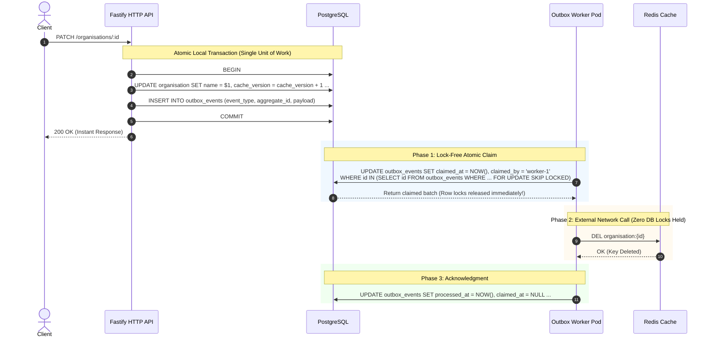

# AI Knowledge Platform — Engineering Journal & Architecture Guide

A production-grade, multi-tenant AI Knowledge Platform backend built with **Node.js**, **TypeScript**, **Fastify**, and **PostgreSQL**.

---

## 📌 Architecture & Design Principles

* **Strict Multi-Tenancy**: Tenant isolation enforced directly in the database engine using PostgreSQL **Row-Level Security (RLS)**.
* **Fail-Closed Security**: Every request must establish authenticated identity and tenant context; missing or invalid contexts fail immediately (`401 Unauthorized`).
* **Privilege Separation**: Database connections switch to a restricted, non-superuser role (`app_user`) with `NOBYPASSRLS` during tenant queries to prevent superuser bypass traps.
* **Connection Pool Safety**: `pg-pool` connections that encounter errors during tenant transactions are evicted (`client.release(err)`) rather than returned tainted.
* **Native ESM & High Performance**: Clean native ECMAScript modules (`"type": "module"`), Node.js native test runner (`node:test`), and `tsx`.

---

## 🚀 Step-by-Step Implementation Log

### Day 1: Foundation, Fastify & Database Infrastructure
1. **Core Runtime**: Node.js v24 + TypeScript with strict compiler options (`noUncheckedIndexedAccess: true`, `exactOptionalPropertyTypes: true`).
2. **Fastify Web Server**:
   * Strict JSON schema validation via Ajv (`coerceTypes: false`, `removeAdditional: false`).
   * Centralized error handler (`registerErrorHandler`) mapping custom domain errors (`AppError`) and PostgreSQL codes (e.g. `23505` unique violation $\rightarrow$ `409 Conflict`) to uniform JSON error structures.
3. **Database & Migrations**:
   * PostgreSQL connection pool (`pg.Pool`) configured with SSL support and environment settings.
   * `node-pg-migrate` integrated for version-controlled, up/down SQL schema migrations.
   * Created initial tables: `organisation` table with unique `slug`.

---

### Day 2: Authentication, Password Hashing & RBAC
1. **User Identity & Security**:
   * Migration creating `users` table linked to `organisation(id)`.
   * Security constraints: `role IN ('owner', 'admin', 'member')` with default `'member'`.
   * Case-insensitive email uniqueness via index `users_email_lower_uidx` on `LOWER(TRIM(email))`.
   * Soft-delete (`is_deleted`) and active account enforcement (`is_active`).
2. **Password Hashing with Argon2id**:
   * Industry-standard password hashing using Argon2id (`timeCost: 3`, `memoryCost: 65536` / 64MB, `parallelism: 4`).
   * Sanitization rule: `password` and `password_hash` are never returned in any API response.
3. **JWT Authentication & Lifecycle**:
   * Fastify JWT plugin (`@fastify/jwt`) with short-lived access tokens (15 minutes).
   * Fastify lifecycle hooks:
     * `authenticate`: Validates bearer token signature and expiration.
     * `requireActiveUser`: Checks account validity (`is_active = 1`, `is_deleted = 0`) and decorates request with tenant and role context.
     * `requireRole(...roles)`: RBAC middleware ensuring authorized access.
4. **Endpoints**:
   * `POST /auth/register`: Atomic registration transaction creating both organization and initial owner user.
   * `POST /auth/login`: Timing-safe credential verification returning access token.
   * `GET /auth/me`: Validates user session and tenant identity.

---

### Day 3: Row-Level Security (RLS) & Multi-Tenant Data Isolation

#### 1. Database Row-Level Security Policy
Created table `knowledge_documents` with mandatory tenant reference:
```sql
CREATE TABLE knowledge_documents (
  id UUID PRIMARY KEY DEFAULT gen_random_uuid(),
  organisation_id UUID NOT NULL REFERENCES organisation(id) ON DELETE CASCADE,
  title TEXT NOT NULL,
  created_at TIMESTAMPTZ NOT NULL DEFAULT now()
);

ALTER TABLE knowledge_documents ENABLE ROW LEVEL SECURITY;
ALTER TABLE knowledge_documents FORCE ROW LEVEL SECURITY;

CREATE POLICY knowledge_documents_tenant_policy ON knowledge_documents
  USING (organisation_id = NULLIF(current_setting('app.organisation_id', true), '')::UUID)
  WITH CHECK (organisation_id = NULLIF(current_setting('app.organisation_id', true), '')::UUID);
```

#### 2. The PostgreSQL Superuser Bypass Trap & The `app_user` Role
* **Problem**: Even with `FORCE ROW LEVEL SECURITY`, PostgreSQL superusers (`rolsuper = true` or `rolbypassrls = true`) bypass RLS policies completely. If an app connects as `postgres`, tests give false confidence.
* **Solution**: Created a dedicated database role `app_user` with `NOSUPERUSER NOBYPASSRLS`. Inside `withTenantTransaction`, every tenant transaction executes:
  ```sql
  SET LOCAL ROLE app_user;
  SELECT set_config('app.organisation_id', $1, true);
  ```

#### 3. Poisoned Connection Pool Prevention
If a query or rollback errors inside a tenant transaction, calling standard `client.release()` returns a broken or session-tainted client back to `pg-pool`. 
We mitigated this by calling `client.release(connectionError)`, forcing `pg-pool` to discard and destroy the connection instead of reusing it.

#### 4. Endpoints
* `GET /documents`: Authenticated route protected by `authenticate` and `requireActiveUser`. Fetches tenant documents using `withTenantTransaction`.

---

## 🧪 Testing Suites & Verification

The project runs **29 automated tests across 6 suites** with 100% pass rate:

```bash
npm test
```

### Breakdown of Test Suites
1. **`test/auth.test.ts`**:
   * Full 6-step authentication lifecycle E2E flow.
   * Valid/invalid registration payloads and rollback integrity.
   * Valid/invalid/expired token lifecycle and inactive user checks.
2. **`test/organisation.test.ts`**:
   * Schema validation, slug uniqueness (409 Conflict), and payload constraints.
3. **`test/documents.test.ts`**:
   * Critical verification: Database connection executes under `app_user` without `BYPASSRLS`.
   * Organization A token $\rightarrow$ returns **only** Org A documents.
   * Organization B token $\rightarrow$ returns **only** Org B documents.
   * Missing token $\rightarrow$ `401 Unauthorized`.
   * Valid token for inactive user $\rightarrow$ `401 Unauthorized`.
4. **`src/modules/documents/documents.rls.test.ts`**:
   * Direct database-level RLS verification ensuring `SELECT id FROM knowledge_documents` (without any explicit SQL `WHERE` clause) strictly isolates tenant rows.

---

## ⚡ Day 3 Baseline Load Test & Performance Metrics

We executed a baseline load test simulating **20 concurrent virtual users (VUs)** over **5 seconds** against `GET /documents`:

```bash
npm run test:load
```

### Baseline Performance Results
* **Total Requests Completed**: `3,727` requests
* **Throughput**: **`743.02` requests / second**
* **Success Rate**: **`100.00%`** (0 HTTP errors, 0 timeouts)
* **Latency Percentiles**:
  * **Min**: `14.53 ms`
  * **Average**: `24.83 ms`
  * **p50 (Median)**: **`23.42 ms`**
  * **p90**: **`29.74 ms`**
  * **p95**: **`32.77 ms`**
  * **p99**: **`44.40 ms`**
  * **Max**: `114.18 ms`
* **Connection Pool Utilization**:
  * Max Active Connections: `10` (max limit of default `pg.Pool`)
  * Max Waiting Queue: `10` requests (VUs queued momentarily during connection checkout)

### Query Execution Plan Analysis (`EXPLAIN ANALYZE, BUFFERS`)
```
Sort  (cost=12.73..12.74 rows=4 width=72) (actual time=0.025..0.026 rows=25 loops=1)
  Sort Key: created_at DESC
  Sort Method: quicksort  Memory: 28kB
  Buffers: shared hit=2
  ->  Bitmap Heap Scan on knowledge_documents  (cost=4.19..12.69 rows=4 width=72) (actual time=0.018..0.019 rows=25 loops=1)
        Recheck Cond: (organisation_id = (NULLIF(current_setting('app.organisation_id'::text, true), ''::text))::uuid)
        Heap Blocks: exact=1
        Buffers: shared hit=2
        ->  Bitmap Index Scan on idx_knowledge_documents_organisation_id  (cost=0.00..4.19 rows=4 width=0) (actual time=0.013..0.013 rows=25 loops=1)
              Index Cond: (organisation_id = (NULLIF(current_setting('app.organisation_id'::text, true), ''::text))::uuid)
              Buffers: shared hit=1
Planning Time: 0.068 ms
Execution Time: 0.041 ms
```

#### Key Query Plan Takeaways:
1. **RLS Transparent Filtering**: PostgreSQL rewrote the query to add the tenant predicate `organisation_id = NULLIF(...)` and scanned through `idx_knowledge_documents_organisation_id`.
2. **Sort Overhead**: Because our current index is only on `(organisation_id)`, PostgreSQL has to fetch the rows and execute an in-memory `quicksort` on `created_at DESC`.
3. **Recommended Optimization (Composite Index)**:
   Adding a composite index on `(organisation_id, created_at DESC)`:
   ```sql
   CREATE INDEX idx_knowledge_documents_org_created_at
   ON knowledge_documents (organisation_id, created_at DESC);
   ```
   This will allow PostgreSQL to perform an **Index Scan** that resolves both the tenant RLS condition and the sort order in one step without any in-memory sort node.

---

### Day 4: Redis Caching, Resilience & High-Concurrency Consistency

#### 1. Redis Infrastructure & Fastify Lifecycles
* **Containerization**: Configured `redis:7-alpine` container running on port `6379`.
* **Client Architecture**: Singleton `createClient` in [`src/db/redis.ts`](src/db/redis.ts) with centralized connection error logging.
* **Fastify Lifecycle Hooks**:
  * `onReady`: Connects to Redis before accepting traffic and verifies connectivity with a ping check.
  * `onClose`: Gracefully disconnects via `redis.quit()`.
* **Health Check**: Added `GET /health/redis` endpoint returning Redis server status.

#### 2. Fail-Open Cache Policy
* For read operations (`GET /organisations/:id`), Redis read and write failures are wrapped in error boundaries (`try/catch`).
* If Redis experiences downtime, network timeouts, or restarts, requests seamlessly fall back to PostgreSQL as the primary source of truth without returning 500 errors to callers.

#### 3. Singleflight Promise Coalescing (Cache Stampede Mitigation)
* **Problem**: When a popular cache key expires or upon a cold start, 100 concurrent requests all miss the cache simultaneously, leading to 100 duplicate database queries (thundering herd / cache stampede).
* **Solution**: In-memory `Map<string, Promise<Organisation | null>>` coalesces all concurrent requests for the same organisation ID into a single shared database lookup promise.
* **Verification Benchmark** ([`scripts/test-concurrent-stampede.ts`](scripts/test-concurrent-stampede.ts)):
  * **100 concurrent cold requests** executed simultaneously.
  * **Database Lookups**: Exactly **1** PostgreSQL lookup.
  * **Success Rate**: **100%** (100 / 100 requests).
  * **Subsequent Request Latency**: **`1.17 ms`** (served directly from Redis cache).

#### 4. Cache Versioning & Stale Repopulation Prevention
* **The Race Condition**: A slow in-flight read starting with old data (`Acme`) could finish after a concurrent database update to `Acme Technologies` and overwrite the freshly invalidated Redis cache with stale data.
* **Database Migration**: Added column `cache_version BIGINT NOT NULL DEFAULT 1` to `organisation` table ([`migrations/1792519203611_add-cache-version-to-organisation.sql`](migrations/1792519203611_add-cache-version-to-organisation.sql)).
* **Atomic Version Guard**:
  When updating an organisation:
  ```sql
  UPDATE organisation
  SET
    name = $2,
    cache_version = cache_version + 1,
    updated_at = NOW()
  WHERE id = $1
  RETURNING id, name, slug, cache_version;
  ```
* In `getOrganisationById`, Redis writes execute an atomic Lua script that compares `organisation:{id}:version`. If a newer version is already recorded in Redis, the stale write is discarded.

#### 5. Post-Commit Cache Invalidation
* **Transaction Rollback Safety**: Cache invalidation must never execute before or during an uncommitted database transaction.
* Database mutations execute within an explicit PostgreSQL transaction block (`BEGIN` ... `COMMIT` / `ROLLBACK`).
* Strictly **after** the transaction successfully commits, cache invalidation is executed:
  ```typescript
  try {
    if (redis.isOpen) {
      await redis.set(`organisation:${id}:version`, String(organisation.cache_version), {
        EX: 300,
      });
    }
    await redis.del(`organisation:${id}`);
  } catch (error) {
    console.error('Organisation cache invalidation failed:', error);
  }
  ```
* If the database transaction fails or is aborted, Redis is never modified, completely preventing dirty cache writes.

#### 6. Endpoints
* `PATCH /organisations/:id` & `PUT /organisations/:id`: Updates organisation name, increments `cache_version`, and triggers post-commit cache invalidation.

#### 7. Transactional Outbox Pattern & Background Worker Daemon

##### 💡 The Distributed Systems Problem: Why Dual-Writes Fail in Production
In modern microservices and high-scale backends, an application frequently needs to write to two different storage engines for a single operation (e.g. update PostgreSQL and invalidate Redis, emit to Apache Kafka, or call Stripe).

###### The Naive Approaches and How They Break:
1. **Write to Database First, Then Network Call (Post-Commit Invalidation)**:
   ```typescript
   await db.updateOrganisation(id, data); // 1. Committed in PostgreSQL
   await redis.del(`organisation:${id}`);  // 2. Network call to Redis
   ```
   * **Failure Mode**: If the Node.js process crashes (OOM killer, AWS ECS spot instance eviction, unhandled exception) or the Redis network blips between steps 1 and 2, PostgreSQL contains the new data while Redis serves stale data for hours or days. The two systems are permanently out of sync.
2. **Execute Network Call Inside the Database Transaction**:
   ```typescript
   await client.query('BEGIN');
   await client.query('UPDATE organisation ...');
   await redis.del(`organisation:${id}`); // ⚠️ DANGEROUS!
   await client.query('COMMIT');
   ```
   * **Failure Mode 1 (Connection Pool Exhaustion)**: PostgreSQL connection pools are scarce (e.g. 10 to 50 connections). If Redis is slow or reconnecting (e.g. 2,000ms delay), PostgreSQL row locks and connections remain frozen for 2 seconds per request. Under 20 concurrent requests, all database connections starve, crashing the entire API for all users.
   * **Failure Mode 2 (Phantom Side-Effects)**: If Redis succeeds but the database transaction subsequently fails (e.g. serialization conflict, constraint violation, or crash), the cache was modified or deleted based on uncommitted dirty data.

---

##### 🛡️ The Solution: The Transactional Outbox Pattern
The Outbox Pattern resolves this dual-write vulnerability by converting two independent distributed writes into **a single atomic local PostgreSQL transaction**:



---

##### 🗄️ Database Schema & Partial Indexing Design

###### Migration 1: Base Table ([`migrations/1792555904650_create-outbox-events-table.sql`](migrations/1792555904650_create-outbox-events-table.sql))
```sql
CREATE TABLE IF NOT EXISTS outbox_events (
  id BIGINT GENERATED ALWAYS AS IDENTITY PRIMARY KEY,
  event_type TEXT NOT NULL,
  aggregate_id UUID NOT NULL,
  payload JSONB NOT NULL,
  created_at TIMESTAMPTZ NOT NULL DEFAULT NOW(),
  processed_at TIMESTAMPTZ,
  attempts INTEGER NOT NULL DEFAULT 0,
  claimed_at TIMESTAMPTZ,
  claimed_by TEXT
);
```

###### Migration 2: Bounded Retries & DLQ ([`migrations/1792556200000_add-retry-columns-to-outbox-events.sql`](migrations/1792556200000_add-retry-columns-to-outbox-events.sql))
```sql
ALTER TABLE outbox_events
ADD COLUMN IF NOT EXISTS last_error TEXT,
ADD COLUMN IF NOT EXISTS failed_at TIMESTAMPTZ,
ADD COLUMN IF NOT EXISTS next_attempt_at TIMESTAMPTZ NOT NULL DEFAULT NOW();

CREATE INDEX IF NOT EXISTS idx_outbox_events_retry
ON outbox_events (next_attempt_at, id)
WHERE processed_at IS NULL
  AND failed_at IS NULL;
```

###### ⚡ Why Partial Indexing (`WHERE processed_at IS NULL AND failed_at IS NULL`)?
In production systems processing millions of events per month, indexing the entire table would cause the index to grow to tens of gigabytes, severely degrading write latency.
* The partial index only indexes the small subset of rows where `processed_at IS NULL AND failed_at IS NULL` (typically 0 to 50 active rows).
* **Index Size**: Remains virtually constant (< 1 MB) regardless of whether the table contains 10,000 or 100,000,000 historical rows.
* **Scan Cost**: Candidate selection is an instantaneous index scan directly hitting the next due events.

---

##### ⚙️ Production Worker Architecture (3-Tier Decoupling)

The worker subsystem is designed as three modular tiers separating batch processing, loop polling, and OS daemon lifecycles:

```
┌────────────────────────────────────────────────────────┐
│  Tier 3: outbox.main.ts (Process Daemon & OS Signals)   │
│  - Traps SIGINT / SIGTERM for zero-downtime rollout    │
│  - Graceful connection teardown (Redis & pg.Pool)      │
└──────────────────────────┬─────────────────────────────┘
                           │
┌──────────────────────────▼─────────────────────────────┐
│  Tier 2: outbox.runner.ts (Polling Loop & Backpressure) │
│  - Dynamic pacing: loops immediately when backlog exists│
│  - Sleeps 1s when idle (prevents CPU spinning)         │
│  - Singleton guard: prevents duplicate competing loops │
└──────────────────────────┬─────────────────────────────┘
                           │
┌──────────────────────────▼─────────────────────────────┐
│  Tier 1: outbox.worker.ts (Core Transactional Logic)   │
│  - Atomic Batch Claim: FOR UPDATE SKIP LOCKED          │
│  - Stale Claim Reclamation: 2-minute lease timeout     │
│  - Out-of-Transaction Network I/O (await redis.del)    │
│  - Bounded Retries with Exponential Backoff (1s - 16s) │
│  - Terminal Dead-Lettering (failed_at after 5 attempts)│
└────────────────────────────────────────────────────────┘
```

---

##### 🔍 Code-Level Walkthrough

###### 1. Atomic Event Generation ([`src/modules/organisation/organisations.service.ts`](src/modules/organisation/organisations.service.ts))
When an organisation update is committed, the outbox event is inserted in the exact same database transaction:
```typescript
await client.query('BEGIN');

const result = await client.query<Organisation>(
  `UPDATE organisation
   SET name = $2, cache_version = cache_version + 1, updated_at = NOW()
   WHERE id = $1
   RETURNING id, name, slug, cache_version;`,
  [id, input.name],
);

organisation = result.rows[0] ?? null;

if (organisation) {
  // Atomically queue invalidation event in PostgreSQL
  await client.query(
    `INSERT INTO outbox_events (event_type, aggregate_id, payload)
     VALUES ('organisation.cache_invalidate', $1::UUID, jsonb_build_object('organisationId', $1::TEXT))`,
    [id],
  );
}

await client.query('COMMIT');
```

###### 2. Safe Batch Claiming with `FOR UPDATE SKIP LOCKED` ([`src/modules/outbox/outbox.worker.ts`](src/modules/outbox/outbox.worker.ts))
```typescript
export async function claimOutboxBatch(
  batchSize = 10,
  claimTimeoutMinutes = 2,
): Promise<ClaimedEvent[]> {
  const result = await pool.query<ClaimedEvent>(
    `UPDATE outbox_events
     SET claimed_at = NOW(),
         claimed_by = $1
     WHERE id IN (
       SELECT id
       FROM outbox_events
       WHERE processed_at IS NULL
         AND failed_at IS NULL
         AND next_attempt_at <= NOW()
         AND (
           claimed_at IS NULL
           OR claimed_at < NOW() - ($2 || ' minutes')::INTERVAL
         )
       ORDER BY next_attempt_at, id
       LIMIT $3
       FOR UPDATE SKIP LOCKED
     )
     RETURNING id, event_type, aggregate_id`,
    [workerId, String(claimTimeoutMinutes), batchSize],
  );

  return result.rows;
}
```
* **`FOR UPDATE SKIP LOCKED`**: Enables running 10 or 100 worker pods simultaneously without race conditions, duplicate processing, or lock contention. When Worker A locks rows 1-10, Worker B immediately skips them and locks rows 11-20.
* **Immediate Lock Release**: The claim query runs and commits immediately, stamping `claimed_by = WORKER_ID`. Database row locks are **not** held open while performing network calls!
* **Stale Claim Recovery (Crash Safety)**: If a worker pod crashes mid-execution (e.g. node killed), its claimed rows are automatically unlocked and retried after 2 minutes (`claimed_at < NOW() - INTERVAL '2 minutes'`).

###### 3. Bounded Retries, Exponential Backoff & Dead-Letter Queue
```typescript
export async function recordOutboxFailure(
  event: ClaimedEvent,
  error: unknown,
): Promise<void> {
  const errorMessage = error instanceof Error ? error.message : String(error);

  try {
    await pool.query(
      `UPDATE outbox_events
       SET attempts = attempts + 1,
           last_error = $3,
           failed_at = CASE
             WHEN attempts + 1 >= 5 THEN NOW()
             ELSE NULL
           END,
           next_attempt_at = CASE
             WHEN attempts + 1 >= 5 THEN next_attempt_at
             ELSE NOW() + (
               LEAST(
                 16,
                 POWER(2, attempts)
               ) * INTERVAL '1 second'
             )
           END,
           claimed_at = NULL,
           claimed_by = NULL
       WHERE id = $1
         AND claimed_by = $2
         AND processed_at IS NULL`,
      [event.id, workerId, errorMessage],
    );
  } catch (releaseError) {
    console.error('Failed to record outbox failure:', releaseError);
  }
}
```
* **Unified Failure Handling**: Handles **both** unexpected network exceptions (e.g. Redis timeouts) and invalid/unsupported event types uniformly.
* **Exponential Backoff**: Schedules next attempt at `LEAST(16, 2^attempts) * 1 second` (2s, 4s, 8s, 16s, 16s). This prevents overwhelming a recovering Redis cluster.
* **Terminal Poison Pill Isolation (DLQ)**: Once `attempts + 1 >= 5`, sets `failed_at = NOW()`. The partial index immediately excludes this row from future worker polls, ensuring bad events never block the processing queue.

---

##### 🏭 Real-World Production Use Cases Handled

| Production Scenario | Potential Disaster | How Our Outbox Architecture Solves It |
| :--- | :--- | :--- |
| **Worker Node Eviction / Pod OOM** | Worker pod dies while holding an event; event is lost forever or stuck. | **Stale Claim Reclamation**: After 2 minutes, other workers detect `claimed_at < NOW() - INTERVAL '2 minutes'` and automatically re-claim the event. |
| **Redis Network Partition / Outage** | Application writes fail or worker spins continuously, saturating CPU. | **Bounded Exponential Backoff**: Retries are delayed (2s $\rightarrow$ 16s). When Redis recovers, events drain cleanly. |
| **Corrupted Payload / Schema Mismatch** | Malformed event crashes worker repeatedly, freezing all subsequent events. | **Dead-Letter Queue (DLQ)**: After 5 failed attempts, the event is marked `failed_at = NOW()` and bypassed without halting the worker. |
| **Horizontal Auto-Scaling (10+ Workers)** | Multiple workers process the same event twice, causing race conditions and deadlocks. | **`FOR UPDATE SKIP LOCKED`**: Concurrency is partitioned seamlessly at the database engine level without distributed lock overhead. |
| **Traffic Spike / Cold Start Backlog** | Worker polling on a fixed sleep interval takes minutes to clear a 50,000-event backlog. | **Dynamic Pacing**: When events exist (`processed > 0`), the runner loops with `0ms` delay to drain the backlog at maximum throughput. |
| **Zero-Downtime Deployment (SIGTERM)** | Pod is killed mid-invalidation, leaving half-finished operations. | **Graceful Shutdown**: Traps `SIGTERM`, allows active batch to finish, disconnects Redis, and closes `pg.Pool` cleanly. |

---

##### 📊 Production Operational Monitoring Query
To inspect backlog health, active processing, and dead-lettered events in production:
```sql
SELECT
  COUNT(*) FILTER (
    WHERE processed_at IS NULL
      AND failed_at IS NULL
  ) AS pending_events,

  COUNT(*) FILTER (
    WHERE processed_at IS NOT NULL
  ) AS processed_events,

  COUNT(*) FILTER (
    WHERE failed_at IS NOT NULL
  ) AS failed_events,

  COUNT(*) FILTER (
    WHERE processed_at IS NULL
      AND failed_at IS NULL
      AND next_attempt_at > NOW()
  ) AS waiting_for_retry
FROM outbox_events;
```

---

##### 🧪 Automated Test Coverage ([`test/outbox.test.ts`](test/outbox.test.ts))
Our automated test suite enforces the entire outbox lifecycle across 5 critical integration tests:
1. **Transactional Event Generation**: Verifies `updateOrganisation` atomically inserts an event into `outbox_events` with `processed_at = null` within the database transaction.
2. **Claim, Invalidate & Acknowledge**: Verifies `processOutboxBatch` claims events, deletes the Redis cache key, stamps `processed_at`, and clears claim markers.
3. **`SKIP LOCKED` Concurrency Isolation**: Spawns concurrent claims to ensure two workers never claim the same event simultaneously.
4. **Failure & Exponential Backoff**: Verifies unsupported event types or network errors trigger `recordOutboxFailure`, advancing `attempts`, capturing `last_error`, and pushing `next_attempt_at` into the future.
5. **Dead-Lettering (Terminal State)**: Verifies that after 5 failed attempts, `failed_at` is populated and the event is permanently excluded from future candidate selection.

---


## 🧪 Testing Suites & Verification

The project runs **32 automated tests across 7 suites** with a 100% pass rate:

```bash
npm test
```

### Breakdown of Test Suites
1. **`test/auth.test.ts`**:
   * Full 6-step authentication lifecycle E2E flow.
   * Valid/invalid registration payloads and rollback integrity.
   * Valid/invalid/expired token lifecycle and inactive user checks.
2. **`test/organisation.test.ts`**:
   * Schema validation, slug uniqueness (409 Conflict), and payload constraints.
3. **`test/documents.test.ts`**:
   * Critical verification: Database connection executes under `app_user` without `BYPASSRLS`.
   * Organization A token $\rightarrow$ returns **only** Org A documents.
   * Organization B token $\rightarrow$ returns **only** Org B documents.
   * Missing token $\rightarrow$ `401 Unauthorized`.
   * Valid token for inactive user $\rightarrow$ `401 Unauthorized`.
4. **`src/modules/documents/documents.rls.test.ts`**:
   * Direct database-level RLS verification ensuring `SELECT id FROM knowledge_documents` strictly isolates tenant rows.
5. **`test/cache-race.test.ts`**:
   * `PATCH /organisations/:id` updates name and increments `cache_version`.
   * Simulates slow in-flight read and verifies that version-guarded writes reject stale data repopulation.
   * Verifies post-commit invalidation: cache key is deleted after transaction commit.
6. **`test/outbox.test.ts`**:
   * Verifies transactional outbox event insertion inside `updateOrganisation`.
   * Verifies batch claiming, Redis cache invalidation, and event acknowledgment.
   * Tests `FOR UPDATE SKIP LOCKED` concurrency isolation between multiple competing workers.
   * Verifies exponential backoff retry scheduling and dead-lettering (`failed_at`) on repeated failures.
7. **`test/rate-limit.test.ts`**:
   * Verifies `/rate-limit-test` endpoint enforcing 5 requests per 60-second fixed window.
   * Requests 1–5 receive `200 OK` with `X-RateLimit-Limit: 5` and decremented `X-RateLimit-Remaining`.
   * Request 6 receives `429 Too Many Requests` with `Retry-After: 60`.

---

## ⚡ Performance Metrics Summary

* **Cache Miss Latency**: `~65 ms` (PostgreSQL query + network round-trip).
* **Cache Hit Latency**: **`~1.17 ms - 3.68 ms`** (**~17.8x - 55x speedup**).
* **Stampede Test**: 100 concurrent cold hits coalesced into 1 database query.
* **Baseline Throughput**: `743.02 req/sec` with median latency `23.42 ms`.

---

## 🚀 Day 5: Redis Rate Limiting & Protection

### 1. Fixed-Window Rate Limiting (`src/modules/rate-limit/`)
* **Service** ([`src/modules/rate-limit/rate-limit.service.ts`](src/modules/rate-limit/rate-limit.service.ts)):
  * Tracks request counts per key with a 60-second expiration window.
  * Calculates `allowed: count <= limit` and `remaining: Math.max(0, limit - count)`.
* **Test Route** ([`src/modules/rate-limit/rate-limit.routes.ts`](src/modules/rate-limit/rate-limit.routes.ts)):
  * Mounted at `GET /rate-limit-test`.
  * Returns rate-limiting headers: `X-RateLimit-Limit`, `X-RateLimit-Remaining`, and `Retry-After: 60` on 429 rejection.

---

## 🔮 Next Steps: Day 5 (Atomic Counter, Sliding-Window & Route Attachment)
* **Atomic Redis Operation**: Replace non-atomic `INCR` + `EXPIRE` with an atomic Lua script to eliminate orphan keys without TTL.
* **Tenant & Auth Rate Limiting**: Attach rate limiters to sensitive authentication routes (`/auth/login`) and tenant API quotas.
* **Tenant Document Caching**: Cache tenant documents with tenant-scoped keys (e.g. `tenant:{orgId}:documents`).